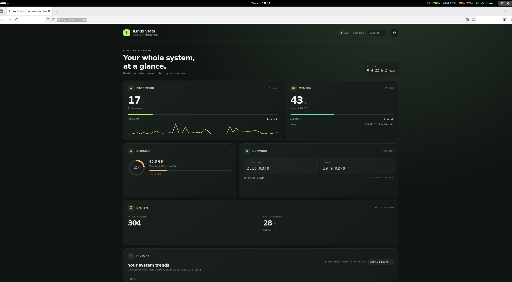

# iLinux Stats

A local Linux system monitor inspired by macOS menu-bar utilities. It provides a live dashboard and an optional GNOME Shell top-bar indicator. Both the dashboard and the GNOME menu are translated into English, French, Spanish, Simplified Chinese, and Japanese. English is the default; each interface has its own language selector.



*Screenshot: live system dashboard and GNOME top-bar widgets.*

## Features

- Live CPU load, core count, frequency, and short-term graph.
- RAM and swap usage, mounted disk usage, and network throughput by interface.
- Uptime, process count, and CPU temperature when the kernel exposes sensors.
- Optional local history for CPU, RAM, disk, and network, with configurable sampling and automatic retention cleanup.
- GNOME top-bar widgets with per-widget visibility, order, format, and color choices.
- No account, cloud service, analytics, or external runtime dependency beyond Python and `psutil`.

## Requirements

- Linux, Python 3.9 or later, and `psutil`.
- A web browser. `run.sh` uses Chromium in app mode when installed, otherwise it opens the default browser.
- `curl` and `xdg-utils` for the launcher.
- GNOME Shell 48 and its `gnome-extensions`/`gsettings` commands for the optional top-bar extension. The web dashboard can also run on other Linux desktop environments.

On Debian 13 or Ubuntu, install the system packages with:

```bash
sudo apt update
sudo apt install python3 python3-psutil curl xdg-utils
```

For the GNOME indicator, install GNOME Shell if it is not already installed:

```bash
sudo apt install gnome-shell
```

On another distribution, install Python 3, `psutil`, `curl`, `xdg-utils`, and (for the top-bar indicator) GNOME Shell 48 using that distribution's package manager.

## Install and run

The quick install downloads the latest published source and installs it in your user account. First install the prerequisites listed above, then run:

```bash
curl -fsSL https://raw.githubusercontent.com/nervusdm/ilinuxstats/main/install-curl.sh | bash
```

The installer does not require `sudo`. You can inspect [the install script](https://github.com/nervusdm/ilinuxstats/blob/main/install-curl.sh) before running it. If you already cloned the repository, use the local installer instead:

```bash
./install.sh
```

It copies the app to `~/.local/share/ilinuxstats`, adds **iLinux Stats** to the applications menu, and enables the GNOME extension. Log out and back in once so GNOME Shell loads a newly installed extension. Then open iLinux Stats from the applications menu, or run:

```bash
./run.sh
```

The dashboard is served only on `http://127.0.0.1:8765`. To run the collector without opening a browser, use `python3 server.py` and visit that address manually.

## Language and configuration

Use the language selector in the dashboard header to choose English, French, Spanish, Simplified Chinese, or Japanese. English is used by default, and your choice is remembered in that browser. To change the GNOME widget menu, click the iLinux Stats indicator in the top bar, open **Language** (or **Langue**) near the top, and select a language. The menu choice is saved on this computer and is independent of the dashboard and desktop language.

Open the gear button to show or hide dashboard modules, change refresh and display settings, and enable history. History collection is off by default. When enabled, choose a 10-second, 30-second, 1-minute, or 5-minute interval and a retention period from 1 to 365 days. Old samples are deleted automatically. The history chart can show the last 6 hours, 24 hours, 7 days, or 30 days.

Click the GNOME top-bar indicator to open a widget's submenu. Each widget can be shown or hidden, displayed as a detailed value, compact value, or mini graph, assigned an automatic or fixed color, and moved left or right. Automatic color changes to orange above 80% and red above 92% for CPU, memory, and disk.

## Data and security

The collector binds to IPv4 loopback (`127.0.0.1`) and does not listen on the LAN. It accepts only the expected local `Host` and same-origin settings requests; cross-site settings writes and non-JSON bodies are rejected. The dashboard sets a restrictive Content Security Policy and makes no external requests. The GNOME extension talks to the local collector only.

There is no authentication on the loopback API. It is intended for the current desktop user's machine, not for a shared server or remote access. Other programs running as the same user can access the local API.

Settings and optional history are stored in `~/.local/state/ilinuxstats/history.sqlite3`. History is opt-in. The state directory is restricted to the current user, and the database is created with user-only permissions. No measurements are uploaded. Temperature readings depend on kernel sensor support.

## Uninstall

Run the installed uninstaller:

```bash
~/.local/share/ilinuxstats/uninstall.sh
```

It removes the app, launcher, and GNOME extension. It asks separately whether to delete the history and configuration; answering **N** keeps them. Browser display preferences are stored in browser `localStorage` and can be removed from that browser's site-data settings for `http://127.0.0.1:8765`.

## Development

```bash
python3 -m venv .venv
. .venv/bin/activate
python -m pip install -r requirements.txt
python server.py
```

Then open `http://127.0.0.1:8765`. The application is plain HTML/CSS/JavaScript plus Python; no frontend build step is required.

---

# iLinux Stats (français)

Moniteur système local pour Linux, inspiré des utilitaires de barre de menus de macOS. Il comprend un tableau de bord en direct et un indicateur optionnel dans la barre supérieure de GNOME. Le tableau de bord et le menu GNOME sont traduits en anglais, français, espagnol, chinois simplifié et japonais. L’anglais est la langue par défaut; chaque interface possède son propre sélecteur.


*Capture : tableau de bord système en direct et widgets dans la barre supérieure de GNOME.*

## Fonctionnalités

- Charge CPU en direct, nombre de cœurs, fréquence et mini-graphique.
- Utilisation de la RAM et du swap, espace des disques montés et débit réseau par interface.
- Temps de fonctionnement, nombre de processus et température CPU si le noyau expose les capteurs.
- Historique local facultatif pour CPU, RAM, disque et réseau, avec cadence réglable et purge automatique.
- Widgets GNOME configurables individuellement : visibilité, ordre, format et couleur.
- Aucun compte, service cloud, outil analytique ou dépendance d’exécution externe autre que Python et `psutil`.

## Prérequis

- Linux, Python 3.9 ou supérieur et `psutil`.
- Un navigateur web. `run.sh` utilise Chromium en mode application s’il est installé, sinon il ouvre le navigateur par défaut.
- `curl` et `xdg-utils` pour le lanceur.
- GNOME Shell 48 et les commandes `gnome-extensions` / `gsettings` pour l’indicateur de barre. Le tableau de bord web fonctionne aussi sur d’autres environnements Linux.

Sous Debian 13 ou Ubuntu, installez les paquets système :

```bash
sudo apt update
sudo apt install python3 python3-psutil curl xdg-utils
```

Pour l’indicateur GNOME, ajoutez GNOME Shell s’il n’est pas déjà installé :

```bash
sudo apt install gnome-shell
```

Sur une autre distribution, installez Python 3, `psutil`, `curl`, `xdg-utils` et, pour l’indicateur, GNOME Shell 48 avec le gestionnaire de paquets de cette distribution.

## Installation et lancement

Après avoir installé les prérequis indiqués plus haut, la commande rapide télécharge la dernière version publiée et l’installe dans votre compte utilisateur :

```bash
curl -fsSL https://raw.githubusercontent.com/nervusdm/ilinuxstats/main/install-curl.sh | bash
```

Elle ne demande pas `sudo`. Vous pouvez [consulter le script d’installation](https://github.com/nervusdm/ilinuxstats/blob/main/install-curl.sh) avant de l’exécuter. Si vous avez déjà cloné le dépôt, lancez plutôt le script local :

```bash
./install.sh
```

Le script copie l’application dans `~/.local/share/ilinuxstats`, ajoute **iLinux Stats** au menu des applications et active l’extension GNOME. Déconnectez-vous puis reconnectez-vous une fois pour charger une nouvelle extension. Lancez ensuite iLinux Stats depuis le menu, ou avec :

```bash
./run.sh
```

Le serveur écoute uniquement sur `http://127.0.0.1:8765`. Pour lancer le collecteur sans ouvrir de navigateur, utilisez `python3 server.py`, puis ouvrez cette adresse vous-même.

## Langue et configuration

Le sélecteur dans l’en-tête permet de choisir l’anglais, le français, l’espagnol, le chinois simplifié ou le japonais. L’anglais est utilisé par défaut et le choix est mémorisé dans le navigateur. Pour changer la langue du widget GNOME, cliquez sur iLinux Stats dans la barre supérieure, ouvrez **Langue** près du haut du menu, puis sélectionnez une langue. Ce choix est mémorisé sur cet ordinateur et est indépendant de la langue du tableau de bord et du bureau.

Le bouton ⚙ permet d’afficher ou masquer les blocs, de régler le rafraîchissement et la présentation, et d’activer l’historique. L’enregistrement est désactivé par défaut. Une fois activé, choisissez une cadence de 10 s, 30 s, 1 min ou 5 min et une conservation de 1 à 365 jours. Les mesures expirées sont purgées automatiquement. Le graphique affiche les 6 dernières heures, 24 heures, 7 jours ou 30 jours.

Cliquez sur l’indicateur GNOME puis ouvrez le sous-menu d’un widget. Vous pouvez l’afficher ou le masquer, choisir une valeur détaillée, compacte ou un mini-graphique, choisir une couleur automatique ou fixe, et déplacer le widget vers la gauche ou la droite. La couleur automatique passe à l’orange au-dessus de 80 % et au rouge au-dessus de 92 % pour le CPU, la mémoire et le disque.

## Données et sécurité

Le collecteur écoute uniquement sur l’interface locale IPv4 (`127.0.0.1`), pas sur le réseau local. Il n’accepte que le `Host` local attendu et les écritures de réglages de même origine; les requêtes intersites et les corps qui ne sont pas en JSON sont refusés. Le tableau de bord définit une politique CSP restrictive et ne fait aucune requête externe. L’extension GNOME communique uniquement avec le collecteur local.

L’API locale n’a pas d’authentification. Elle est prévue pour le bureau de l’utilisateur courant, pas pour un serveur partagé ou un accès distant. Les autres programmes exécutés sous le même compte peuvent accéder à l’API.

Les préférences serveur et l’historique facultatif sont dans `~/.local/state/ilinuxstats/history.sqlite3`. L’enregistrement est désactivé par défaut. Le dossier d’état est réservé à l’utilisateur courant et la base est créée avec des permissions privées. Aucune mesure n’est envoyée. La température dépend de la prise en charge des capteurs par le noyau.

## Désinstallation

Lancez le désinstalleur installé :

```bash
~/.local/share/ilinuxstats/uninstall.sh
```

Il retire l’application, le raccourci et l’extension GNOME, puis demande séparément s’il faut supprimer l’historique et la configuration. Répondez **N** pour les conserver. Les préférences visuelles du navigateur sont dans son `localStorage`; vous pouvez les supprimer dans les données de site du navigateur pour `http://127.0.0.1:8765`.

## Développement

```bash
python3 -m venv .venv
. .venv/bin/activate
python -m pip install -r requirements.txt
python server.py
```

Ouvrez ensuite `http://127.0.0.1:8765`. L’application utilise HTML/CSS/JavaScript et Python; aucune étape de compilation frontend n’est nécessaire.
